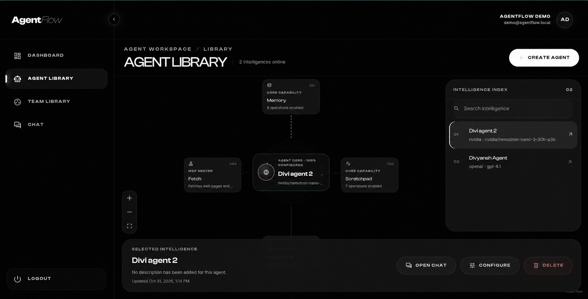
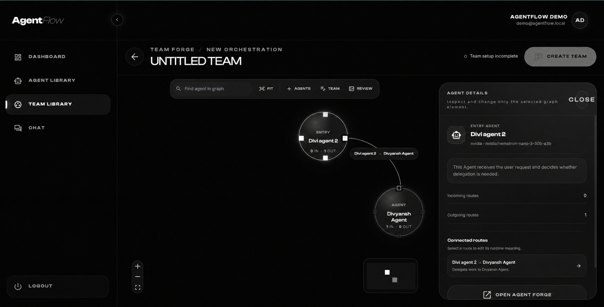
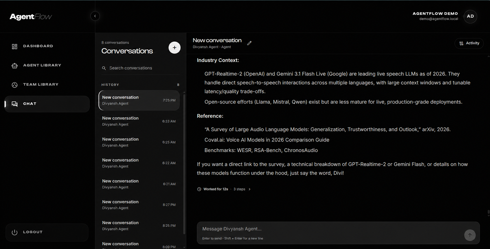
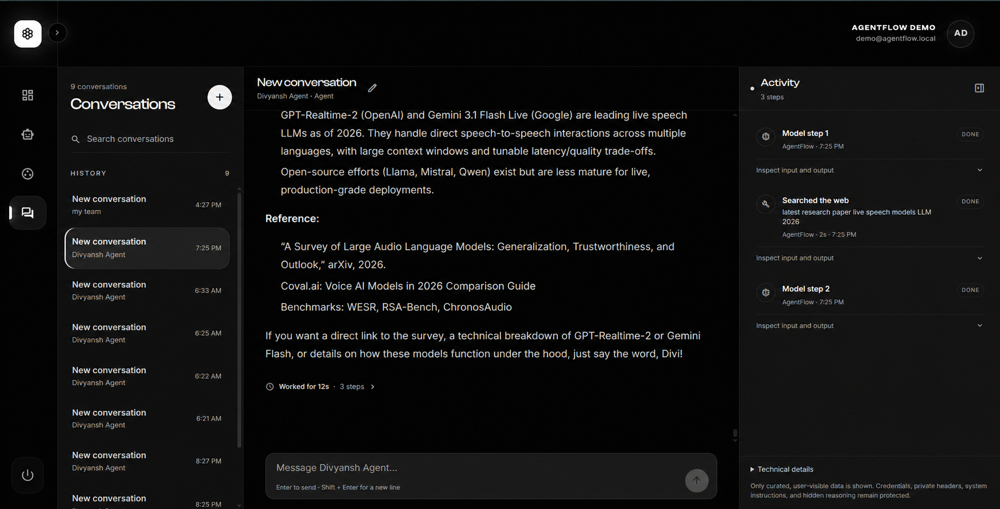
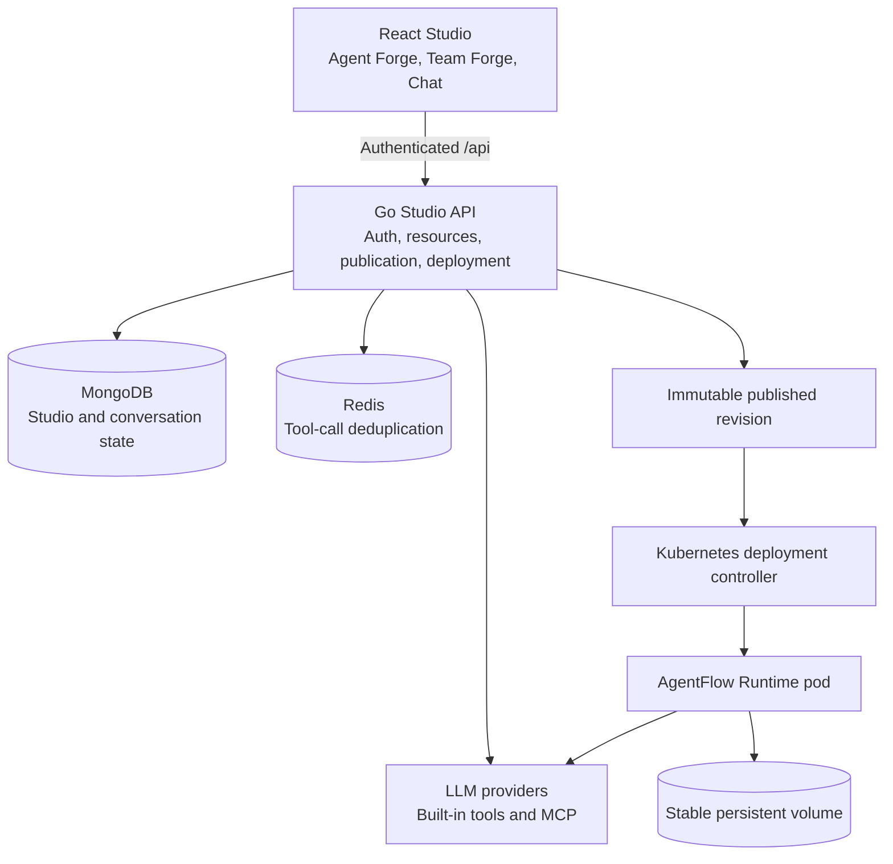

<div align="center">

# AgentFlow

### Design agents. Connect teams. Inspect every step.

AgentFlow is a visual platform for building, running, and deploying tool-using AI agents and multi-agent systems.

[](https://github.com/Divi-1910/AgentFlow/actions/workflows/ci.yml)
[](backend/go.mod)
[](frontend/package.json)
[](deploy/kubernetes/README.md)

</div>


AgentFlow combines a visual studio, a durable Go execution engine, inspectable chat activity, Model Context Protocol (MCP) connectivity, and managed Kubernetes deployment. You can follow an agent from its model and capabilities to every tool call, delegation, memory mutation, and published runtime revision.

## What you can build

AgentFlow supports individual agents and directed agent teams without forcing every workflow into a supervisor and worker hierarchy.

| Surface         | What it does                                                                                           |
| --------------- | ------------------------------------------------------------------------------------------------------ |
| **Agent Forge** | Configure an agent's identity, instructions, model, tools, MCP servers, memory, and scratchpad         |
| **Team Forge**  | Connect reusable agents into a directed delegation graph with explicit caller and callee relationships |
| **Chat**        | Stream model output while preserving a readable transcript and a detailed execution trail              |
| **Memory**      | Store durable, scoped facts with revision history and replay-safe mutation identities                  |
| **Scratchpad**  | Give collaborating agents a shared workspace for plans, findings, and structured artifacts             |
| **Publishing**  | Freeze a validated agent or team graph into an immutable revision                                      |
| **Deployment**  | Reconcile one Kubernetes runtime pod and one stable persistent volume per deployment                   |

## Why AgentFlow

An agent is more than a prompt and a model call. It is an executable system with state, capabilities, failure boundaries, and operational history.

AgentFlow keeps those parts explicit:

- **Visible configuration**: models, tools, and MCP capabilities appear on the canvas
- **Directed delegation**: each team edge states which agent can call which agent
- **Inspectable execution**: chat activity shows model steps, tool inputs and outputs, delegation, memory, scratchpad, and safe failures
- **Durable state**: MongoDB stores Studio resources and conversations; deployed runtimes keep their own persistent state
- **Immutable delivery**: publishing creates a new revision instead of modifying history
- **Stable deployment identity**: newer revisions reuse the deployment's persistent volume
- **Platform-owned credentials**: provider keys remain on the backend and never enter browser configuration

## Product tour

The Studio uses one visual language across authentication, workspace management, agent design, team orchestration, and chat.

<table>
  <tr>
    <td width="50%">
      
      <p align="center"><strong>Product entry</strong></p>
    </td>
    <td width="50%">
      
      <p align="center"><strong>Authentication</strong></p>
    </td>
  </tr>
  <tr>
    <td width="50%">
      
      <p align="center"><strong>Agent Library</strong></p>
    </td>
    <td width="50%">
      
      <p align="center"><strong>Team Forge</strong></p>
    </td>
  </tr>
  <tr>
    <td width="50%">
      
      <p align="center"><strong>Streaming chat</strong></p>
    </td>
    <td width="50%">
      
      <p align="center"><strong>Execution activity</strong></p>
    </td>
  </tr>
</table>

## Run AgentFlow with Docker Compose

Docker Compose starts the Studio frontend, Go backend, MongoDB, and Redis. It preserves MongoDB, memory, scratchpad, and Redis data across container restarts.

### Prerequisites

Install Docker Engine with the Compose plugin. Add at least one provider credential if you want to execute model calls.

### 1. Create local configuration

Copy the environment template:

```bash
cp .env.example .env
```

Generate a signing secret:

```bash
openssl rand -hex 32
```

Set the generated value as `JWT_SECRET` in `.env`. Add the provider keys that AgentFlow should own.

### 2. Start the stack

Build and start every service:

```bash
docker compose up --build
```

Open [http://localhost:5174](http://localhost:5174). The backend remains available at [http://localhost:9090/health](http://localhost:9090/health) for direct health checks.

### 3. Stop the stack

Stop the containers without deleting stored data:

```bash
docker compose down
```

Delete the containers and all Compose-managed data only when you want a fresh local environment:

```bash
docker compose down --volumes
```

### Compose environment variables

The frontend receives none of these secrets. Compose injects provider credentials only into the backend container.

| Variable             | Required | Purpose                                                       |
| -------------------- | -------- | ------------------------------------------------------------- |
| `JWT_SECRET`         | Yes      | Signs local AgentFlow sessions                                |
| `OPENAI_API_KEY`     | No       | Enables OpenAI models registered in the Studio catalog        |
| `ANTHROPIC_API_KEY`  | No       | Enables Anthropic models registered in the Studio catalog     |
| `NVIDIA_API_KEY`     | No       | Enables NVIDIA-hosted models registered in the Studio catalog |
| `TAVILY_API_KEY`     | No       | Enables the built-in web search tool                          |
| `AGENTFLOW_WEB_PORT` | No       | Changes the host frontend port from `5174`                    |
| `AGENTFLOW_API_PORT` | No       | Changes the host backend port from `9090`                     |

Managed Kubernetes deployment stays disabled in the Compose stack. Use the Kubernetes installation path when you want AgentFlow to create deployed runtime pods.

## Run the development servers

Use the host development workflow when you want Vite hot module replacement or direct access to local MCP processes.

### Backend

Install Go 1.25, MongoDB, and `rg` from ripgrep. Then create `backend/.env` with `MONGO_URL`, `JWT_SECRET`, and any provider credentials.

Start the API:

```bash
cd backend
go run .
```

The API listens on `http://localhost:9090` by default.

### Frontend

Install Node.js and start Vite:

```bash
cd frontend
npm install
npm run dev
```

Vite proxies `/api` to `http://localhost:9090`. Override the development target when the backend uses another address:

```bash
VITE_DEV_API_TARGET=http://localhost:8080 npm run dev
```

## Connect local MCP servers

AgentFlow connects to MCP servers but does not own or supervise them. The local harness runs five independent development servers:

- Sequential Thinking
- Fetch
- Python Sandbox
- Math & Utilities
- Open-Meteo

## Understand the architecture

AgentFlow separates editable Studio resources from immutable deployed revisions. This boundary lets you continue editing an agent without changing a running deployment.



### Studio execution path

The runtime owns control flow. A strategy decides the next action, while the runtime executes that action and records the result.

```text
HTTP request
  -> authentication and product handler
  -> thread, message, and run persistence
  -> dispatcher and agent runtime loop
  -> model, tool, MCP server, or delegated agent
  -> checkpoints and persisted execution events
  -> Server-Sent Events stream and final message
```

The action contract supports `tool`, `delegate`, `respond`, and `plan_update`. ReAct agents and multi-agent delegation use the same runtime contract.

### Publishing and deployment

Publishing walks the reachable graph and validates every referenced model, tool, agent, and MCP server. It then stores an immutable configuration bundle with a unique revision identity.

Managed deployment uses a forward-only model:

1. Publish the current editable resource
2. Select a revision to deploy
3. Create a new desired deployment generation
4. Reconcile one runtime pod for the agent or team
5. Preserve the deployment's persistent volume across revisions
6. Expose status and runtime APIs through the authenticated backend proxy

Deploying an older configuration does not mutate history. AgentFlow creates a new revision from the older configuration.

## Explore the API surface

The authenticated product API covers the complete Studio execution path:

- authentication and session restoration
- workspace overview and platform capabilities
- model, tool, and MCP catalogs
- agent and agent-team create, read, update, and delete operations
- publication, revision history, bundle export, and forward restore
- threads, messages, runs, cancellation, and resume
- persisted run events through Server-Sent Events (SSE)
- managed deployment status, deploy, undeploy, and runtime proxy routes

The router in [`backend/main.go`](backend/main.go) is the current API contract. The frontend centralizes authentication, JSON handling, streaming, and `401` invalidation in [`frontend/src/api/client.js`](frontend/src/api/client.js).

## Repository map

The repository keeps product, runtime, and infrastructure concerns separate:

```text
backend/         Studio API, execution engine, persistence, publisher, controller
frontend/        React Studio and production Nginx image
mcp_servers/     Local-only independent MCP development harness
deploy/          Kubernetes manifests and deployment contract
docs/            Backend and frontend architecture guides and screenshots
scripts/ci/      Shared quality gates for local CI, Jenkins, and GitHub Actions
```

Read the deeper guides when you need implementation-level detail:

- [`docs/BACKEND_ARCHITECTURE_GUIDE.md`](docs/BACKEND_ARCHITECTURE_GUIDE.md): backend layers, execution flow, persistence, failure boundaries, and deployment decisions
- [`docs/FRONTEND_ARCHITECTURE_GUIDE.md`](docs/FRONTEND_ARCHITECTURE_GUIDE.md): frontend boundaries, routing, API access, state ownership, and UI architecture
- [`frontend/README.md`](frontend/README.md): frontend development and API configuration
- [`mcp_servers/README.md`](mcp_servers/README.md): MCP process control and local catalog setup
- [`deploy/kubernetes/README.md`](deploy/kubernetes/README.md): Kubernetes prerequisites, trust boundaries, and operational contract

## Run the quality gates

The repository uses the same scripts in local automation, Jenkins, and GitHub Actions.

Run the frontend checks:

```bash
bash scripts/ci/frontend.sh
```

Run backend checks against a disposable MongoDB test database:

```bash
MONGO_TEST_URI=mongodb://127.0.0.1:27017 \
  bash scripts/ci/backend.sh
```

The backend script runs formatting verification, `go mod tidy -diff`, `go vet`, the full Go test suite, focused race detection, and a complete build. The frontend script installs the locked dependency graph, runs ESLint and Vitest, then creates the production bundle.

AgentFlow includes two continuous integration paths:

- [GitHub Actions CI](.github/workflows/ci.yml) checks the frontend, backend, race-sensitive packages, and container builds
- `Jenkinsfile.frontend` and `Jenkinsfile.backend` expose equivalent independent Jenkins jobs

The [release workflow](.github/workflows/release.yml) runs for version tags or manual dispatch. It uploads the frontend distribution and publishes Studio and Runtime images to GitHub Container Registry (GHCR) with source commit and version tags.

Release delivery does not modify a Kubernetes cluster. Operators retain control of cluster credentials, immutable image digests, storage classes, ingress, Transport Layer Security (TLS), and provider secrets.

## Deploy to Kubernetes

The manifests under [`deploy/kubernetes`](deploy/kubernetes) define the baseline Studio and runtime trust boundaries. They are not a universal cluster installer.

Before deployment, provide:

- immutable Studio and Runtime image digests
- AgentFlow-owned provider credentials in Kubernetes secrets
- artifact delivery TLS
- a compatible `ReadWriteOnce` storage class
- ingress and Domain Name System (DNS) configuration
- independently deployed MCP service URLs

Apply the configured manifests:

```bash
kubectl apply -k deploy/kubernetes
```

Read [`deploy/kubernetes/README.md`](deploy/kubernetes/README.md) before applying them to a cluster.

## Current project status

AgentFlow currently implements the core Studio workflow, reusable Agent and Team templates, agent and team execution, chat activity, memory, scratchpad, MCP connectivity, immutable publication, and managed Kubernetes deployment management in the Studio. The next public-product milestones include a maintained model-catalog bootstrap path, browser-level end-to-end tests, security hardening, and stable release documentation.

## License

No license has been declared. All rights remain with the repository owner until an explicit license is added.
